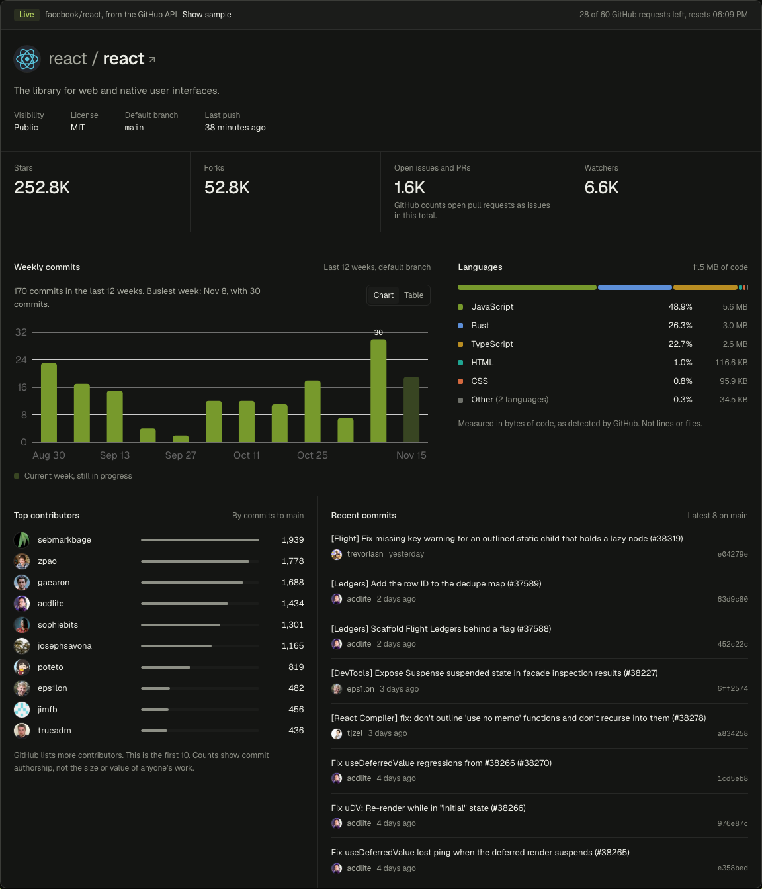
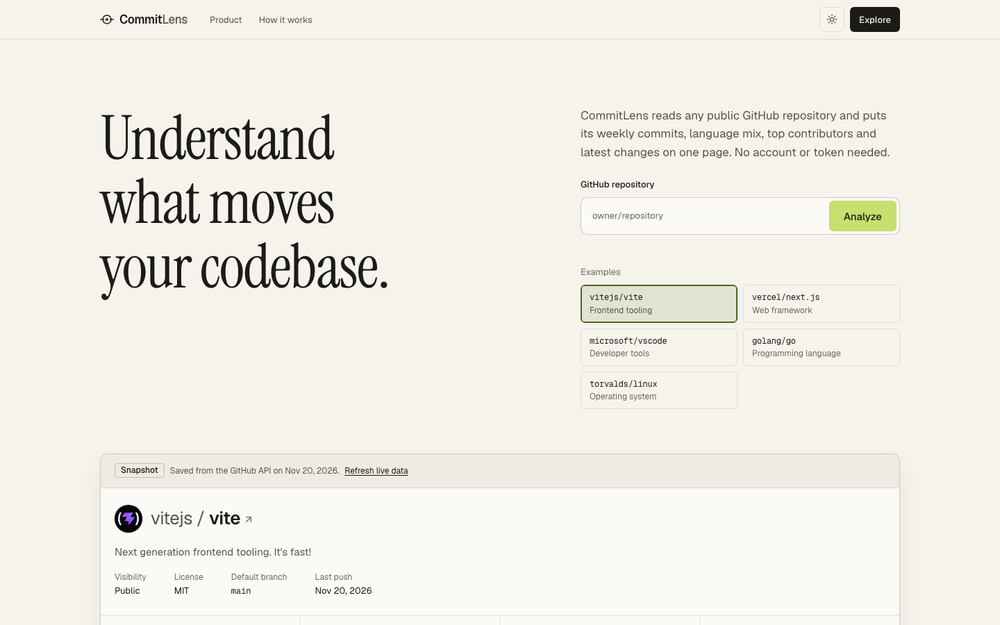
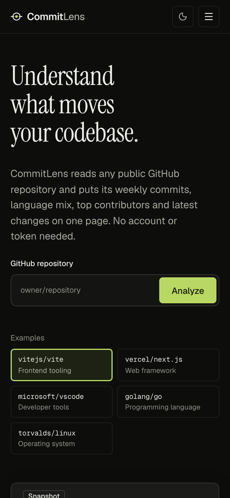

# CommitLens

**Understand what moves your codebase.**

CommitLens analyzes any public GitHub repository in the browser. It shows weekly commit activity, language share by bytes of code, top contributors and recent commits on one page. It needs no account, no token and no backend.



| Landing page (light)                                | Mobile (dark)                               |
| --------------------------------------------------- | ------------------------------------------- |
|  |  |

## Features

- **Repository analysis from real GitHub data.** Accepts `owner/repo`, `github.com/owner/repo` and full URLs, including `/tree/...` paths and `.git` suffixes.
- **Accurate metrics.**
  - "Open issues and PRs" is labeled as such, because GitHub's `open_issues_count` includes pull requests.
  - The contributor list says when GitHub has more contributors than the first page.
  - Language share is labeled as bytes of code.
  - Missing values show "Unavailable", never a fake zero.
- **Weekly commits for the latest 12 weeks.** The unfinished current week is marked. The chart has a tooltip, a text summary and a table view.
- **Five example repositories with saved snapshots.** `vitejs/vite` (shown on load), `vercel/next.js`, `microsoft/vscode`, `golang/go` and `torvalds/linux`. Each snapshot is real GitHub API data with its own capture date. Switching between examples makes no API requests, so the page stays complete when GitHub is down or the rate limit is spent.
- **Refresh live data.** One click loads current GitHub data for the selected example. The snapshot stays on screen until live data arrives. If the refresh fails, the snapshot stays and a notice explains the error. Snapshot data is tagged "Snapshot" with its date, and live data is tagged "Live".
- **Every state covered.** Loading skeletons, partial success, empty states, invalid input, private or missing repositories, network errors, rate limits with the reset time, and statistics still being computed (HTTP 202).
- **Shareable links.** `?repo=owner/name` opens an analysis directly.
- **Light and dark themes.** The first visit follows the system setting. An explicit choice is saved.
- **Remaining quota display.** The meter shows how many anonymous GitHub requests are left. It reads the response headers, so it costs no extra request.

## Technology

| Concern      | Choice                                                                                    |
| ------------ | ----------------------------------------------------------------------------------------- |
| UI           | React 19, JavaScript (ES2022), CSS Modules, CSS custom properties                         |
| Build        | Vite 8, build-time prerendering                                                           |
| Server state | TanStack Query 5                                                                          |
| Theme        | React Context over a small external store                                                 |
| Charts       | Recharts 3 (lazy-loaded)                                                                  |
| Motion       | Motion 14 (`LazyMotion`, reduced-motion aware)                                            |
| Icons        | Lucide                                                                                    |
| Fonts        | Instrument Serif, Geist, Geist Mono (self-hosted with Fontsource)                         |
| Quality      | ESLint 9 (with `jsx-a11y`), Prettier, Vitest, React Testing Library, Playwright, axe-core |

## Getting started

Requires Node.js 20.19 or newer.

```bash
npm install
npm run dev          # http://localhost:5173
```

### Production build

```bash
npm run build        # client build + SSR build + prerender into dist/
npm run preview      # serves dist/ on http://localhost:4173
```

Optional environment variables (see `.env.example`):

| Variable              | Effect                                                                                                     |
| --------------------- | ---------------------------------------------------------------------------------------------------------- |
| `VITE_REPOSITORY_URL` | Shows a GitHub link to the source in the header and footer                                                 |
| `VITE_SITE_URL`       | Adds the canonical URL, absolute Open Graph URLs, `robots.txt` with a sitemap reference, and `sitemap.xml` |

### Tests

```bash
npm test             # unit and component tests (Vitest)
npm run test:e2e     # end-to-end tests (Playwright; builds and serves dist/)
npm run lint
npm run format:check
npm run check        # lint + format + unit tests + build
npm run smoke:live   # optional: real GitHub API smoke test (uses about 5 requests)
npm run snapshots    # re-capture the example snapshots from the real API (about 25 requests)
```

Run `npx playwright install chromium` once before the first end-to-end run. All automated tests mock the GitHub API, so they never depend on GitHub availability or quota.

## Architecture

```
src/
  app/            App composition, providers, query client, site config
  components/
    layout/       Header (with mobile menu), footer, container, skip link
    ui/           Button, logo, avatar, skeleton, external link
  features/
    landing/      Hero, capabilities, how it works, final call to action
    repository/
      api/        GitHub client, endpoint functions, typed errors
      components/ Explorer, panels, charts, lists, form
      hooks/      Analysis queries, URL sync, rate-limit subscription
      utils/      Input parsing, normalization, section state
    theme/        Theme store, context, toggle
  data/           Example list and their snapshots (real API data, labeled in the UI)
  styles/         Design tokens and global styles
  utils/          Formatting, hydration helper
  test/           Test setup, fixtures, render helper
e2e/              Playwright tests with a mocked GitHub API
scripts/          Prerender and live smoke test
```

The UI never reads raw GitHub JSON. API functions return normalized data, and every panel renders loading, error and empty states through one `Panel` component. See [docs/ARCHITECTURE.md](docs/ARCHITECTURE.md) for the request flow, the error policy and the rendering details.

## GitHub API integration

CommitLens uses five endpoints of the [GitHub REST API](https://docs.github.com/en/rest):

```text
GET /repos/{owner}/{repo}
GET /repos/{owner}/{repo}/languages
GET /repos/{owner}/{repo}/contributors?per_page=10
GET /repos/{owner}/{repo}/stats/commit_activity
GET /repos/{owner}/{repo}/commits?per_page=8
```

- **Gate first.** The repository request runs first. A typo costs one request, not five.
- **Canonical names.** Section requests use the name from the repository response. A renamed repository then costs 6 requests instead of 10.
- **Caching and deduplication.** TanStack Query caches results and merges identical in-flight requests. Stale times are 5 minutes for metadata and commits, and 1 hour for statistics. Analyzing the same repository again in that window costs nothing.
- **Cancellation.** Every request receives the query's `AbortSignal`.
- **Bounded retries.** Network and 5xx errors retry twice. HTTP 202 (statistics computing) retries three times with backoff, then offers "Try again". Rate limits and 4xx errors never retry automatically.
- **No polling and no secrets.** Requests start only after a deliberate action: submit, an example click, or opening a `?repo=` link.

## Technical decisions and trade-offs

- **Client-side only.** The brief requires no accounts or tokens, and all data is public. A backend would add hosting, secrets and a failure point without adding data. The cost is the anonymous limit of 60 requests per hour per IP address. CommitLens reduces it with caching, gating, canonical names and the bundled snapshots, and shows the remaining quota. A small proxy with a server-side token is the upgrade path if usage grows.
- **TanStack Query** handles caching, deduplication, cancellation, retries and per-section status. Writing that by hand would mean more code and more bugs. Redux would add ceremony for state that is almost all server state.
- **CSS Modules with custom properties** give scoped styles and one token file that drives both themes, with no runtime cost and no utility-class noise. The design has few components, so a component library would add weight and a borrowed look.
- **Build-time prerendering** instead of a framework. One small script (`scripts/prerender.js`) gives full HTML for SEO and first paint. The SPA architecture stays the same.
- **Recharts only where it pays.** The weekly commit chart needs axes, tooltips and keyboard access, so it uses Recharts in a lazy chunk. Language share and contributor bars are plain HTML and CSS, which is lighter and easier to make accessible.
- **Bundled snapshots.** The example snapshots are real API responses, normalized with the same code as live data and saved by `npm run snapshots`. A section GitHub refused at capture time is stored as its real error and shown as unavailable. Nothing is invented. The snapshots are bundled with the app (a few KB gzipped each), so switching examples is instant and costs no requests. To add an example, add one line to `src/data/exampleRepositories.js` and run `npm run snapshots -- owner/repo`.
- **ESLint 9, not 10.** `eslint-plugin-jsx-a11y` has no ESLint 10 release yet. ESLint 9 is end-of-life, but accessibility linting matters more here. Upgrade when the plugin supports ESLint 10.
- **Fixed `en-US` formatting.** The page is in English, and prerendered HTML must match the first client render.

## Quality results (measured 2026-11-20)

| Check                                          | Result                                                                                                          |
| ---------------------------------------------- | --------------------------------------------------------------------------------------------------------------- |
| Unit and component tests                       | 102 passed                                                                                                      |
| End-to-end tests (Chromium)                    | 17 passed, including axe checks (WCAG 2.2 AA tags) on live and snapshot views in both themes with 0 violations  |
| Lighthouse, mobile (local preview)             | Performance 100, Accessibility 100, Best Practices 100, SEO 100                                                 |
| Lighthouse, desktop (local preview)            | Performance 100, Accessibility 100, Best Practices 100, SEO 100                                                 |
| Core Web Vitals (Lighthouse mobile, simulated) | FCP 0.8 s, LCP 0.8 s, TBT 30 ms, CLS 0                                                                          |
| Bundle (gzip)                                  | Main JS 119 KB (includes the five snapshots), chart chunk 119 KB (lazy), motion features 19 KB (lazy), CSS 7 KB |
| Live API smoke test                            | `vitejs/vite` and `facebook/react` (redirects to `react/react`) analyzed successfully                           |

Lighthouse ran against `vite preview` on localhost, so production numbers on a CDN can differ. Lighthouse's experimental "Agentic Browsing" category scored 50. CommitLens ships `llms.txt` but no WebMCP or ARD manifests, because they were not in scope.

## Accessibility

- Semantic landmarks, one `h1` and an ordered heading hierarchy, plus a skip link.
- Visible focus indicators. After an analysis starts, focus moves to the results.
- A visible, linked label on every input. Errors use `aria-invalid`, `aria-describedby` and `role="alert"`.
- A polite live region announces loading, success and unavailable sections.
- The chart has a text summary, a table view and Recharts' keyboard layer. Every color-coded series also has a text legend.
- Chart colors were checked for color-vision-deficiency separation and 3:1 contrast in both themes.
- Motion respects `prefers-reduced-motion`.
- The mobile menu sets `aria-expanded`, closes with Escape and on outside clicks, and returns focus to the menu button.

## Known limitations

- **Anonymous rate limit.** 60 requests per hour per IP address, shared by everyone behind the same network address. Each new analysis or live refresh uses 5 requests (6 for a renamed repository). Choosing an example uses none.
- **Default branch only.** Commit activity, contributors and recent commits cover the default branch, as GitHub computes them.
- **Statistics delay.** For repositories GitHub has not cached, statistics can take more than the retry window. The panel then offers "Try again".
- **Very large repositories.** GitHub may refuse contributor lists for very long histories. The panel explains this.
- **Partial contributor list.** Only the first page is shown. Exact totals would need more requests.
- **No private repositories.** By design, there is no sign-in.
- **English only.** Numbers and dates use the `en-US` format, and dates use UTC.
- **Snapshots age.** Each snapshot shows its capture date. To update them, run `npm run snapshots`.
- **Refresh shows a mixed state briefly.** After the repository request of a refresh succeeds, the dashboard switches to live data, and the remaining sections load in place. If one of those sections then fails, that panel shows its live error. It does not fall back to snapshot data, because mixing dates in one view would mislead.

## Deployment (Vercel)

The project is ready for Vercel. Nothing has been deployed.

1. Push the repository to GitHub and import it in Vercel. `vercel.json` sets the build command (`npm run build`), the output folder (`dist`), long-term caching for hashed assets, and basic security headers.
2. Set `VITE_SITE_URL` (for example `https://commitlens.vercel.app`) to get canonical URLs, absolute Open Graph URLs, `robots.txt` and `sitemap.xml`. Optionally set `VITE_REPOSITORY_URL`.
3. Redeploy after you set the variables. Prerendering reads them at build time.

Next steps: add a Content Security Policy (the inline theme script needs a hash), and add CI for `npm run check` and `npm run test:e2e`.

## Project notes

- `.claude/skills/unslop-ui/`: the reviewed, project-scoped copy of the [unslop-ui](https://github.com/felipebasurto/unslop-ui) skill (MIT), used for the design review.

## Data and attribution

Repository data comes from the [GitHub REST API](https://docs.github.com/en/rest). CommitLens is an independent project. It is not affiliated with or endorsed by GitHub. Commit counts show authorship only. They are not a measure of anyone's productivity or the value of their work.

## License

CommitLens is released under the [MIT License](LICENSE).

The unslop-ui skill in `.claude/skills/unslop-ui/` keeps its own MIT license, in that folder.
